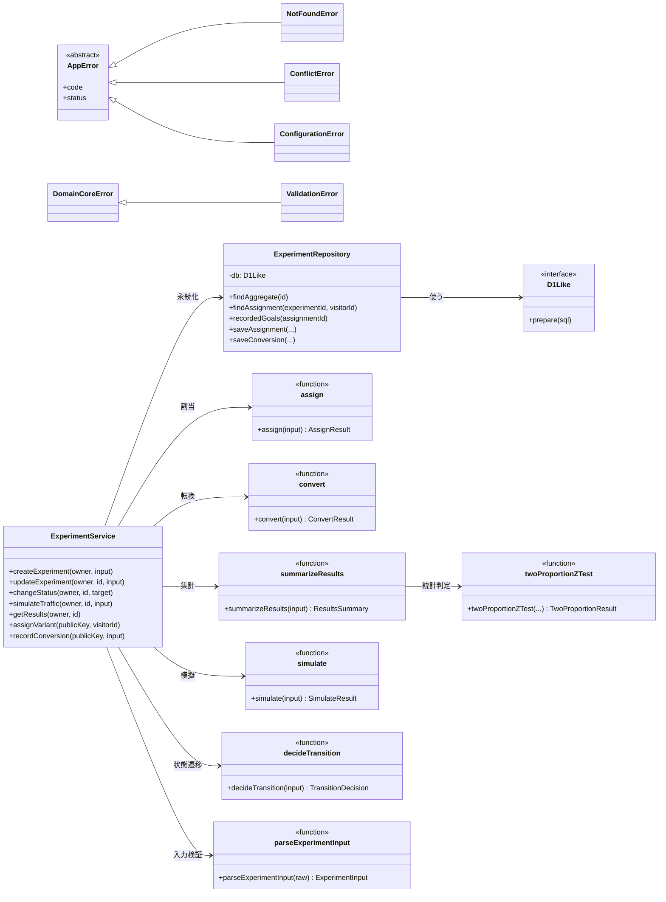

# クラス図（実装済み）

本書は、主要なクラスと関数（モジュール）の関係を示します。Domain Core（`src/core/`）は HTTP 層から分離した純粋関数です。図は Mermaid で書いています。

## 要点

- `ExperimentService` が唯一の入口で、Domain Core の関数を組み合わせ、`ExperimentRepository` に保存します。
- `assign`・`convert`・`summarizeResults`・`simulate`・`decideTransition` は、D1 を直接触りません（純粋関数）。
- 例外は、ドメインの例外（`DomainCoreError`・`ValidationError`）と、HTTP に返す例外（`AppError` 系）に分けています。
- 文字列の正は `src/config/` に置いています。
