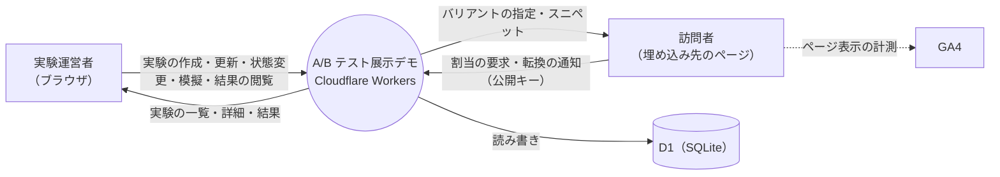
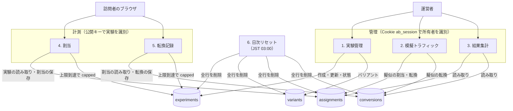

# データフロー図（DFD・実装済み）

本書は、データがどこから入り、どこで処理され、どこに保存されるかを示します。図は Mermaid で書いています。

## レベル 0（コンテキスト図）

## レベル 1（処理の分解）

## 要点

- 管理の処理（1〜3）は、Cookie の `owner_session_id` で絞り込みます。他人の実験は見えません。
- 計測の処理（4・5）は Cookie を使わず、公開キーで実験を引きます。
- 個人情報は流れません。訪問者 ID は、ブラウザ内で生成した乱数です。
