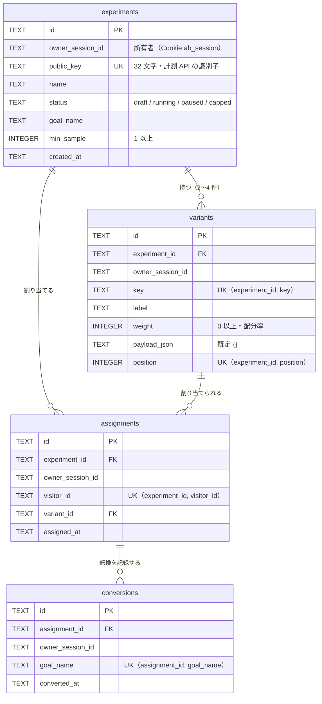

# ER 図（実装済みのスキーマ）

本書は `migrations/0001_init.sql` のスキーマ（D1 / SQLite）を図にしたものです。日次リセット（JST 03:00）で全行を削除します。

## 関係と制約

| 関係 | 内容 |
|---|---|
| experiments → variants | 1 実験に 2〜4 件のバリアント。`(experiment_id, key)` と `(experiment_id, position)` は一意 |
| experiments → assignments | 1 実験の中で、訪問者 ID ごとに 1 件の割当。`(experiment_id, visitor_id)` は一意 |
| variants → assignments | 割当は 1 つのバリアントを指す |
| assignments → conversions | 割当ごとに、ゴール名ごとに 1 件まで。`(assignment_id, goal_name)` は一意 |

## 設計上の要点

- すべてのテーブルに `owner_session_id` を持たせ、ダッシュボードのクエリを所有者で絞り込みます。計測 API はセッションを持たないため、公開キー（`experiments.public_key`）で実験を引きます。
- `experiments.public_key` は 32 文字で一意です（`CHECK (length(public_key) = 32)`）。
- 露出数は `assignments` の件数、転換数は `conversions` の件数で集計します。
- 上限（1 実験あたり 10,000 件）は、`assignments` の件数と `conversions` の件数の合計で判定します。
