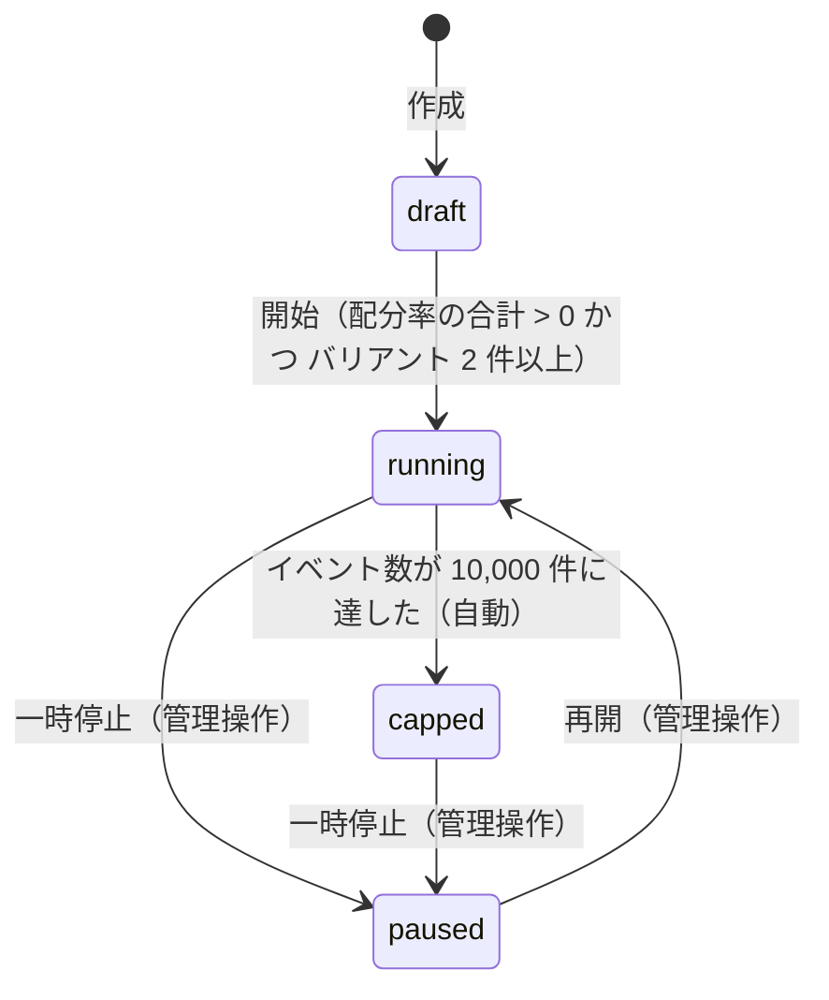

# 状態遷移と処理の流れ（実装済みのもの）

本書は `src/core/transitions.ts`・`src/core/assign.ts`・`src/core/convert.ts` の判定に合わせて書きました。判定はどれも純粋関数で、保存は呼び出し側（`src/services/experiment-service.ts`）が行います。

## 1. 実験の状態遷移

| 遷移 | 扱い |
|---|---|
| draft → running | 配分率の合計が 0 以下、またはバリアントが 2 件未満なら拒否 |
| running ⇄ paused | 管理操作で許可 |
| running → capped | イベント数が上限に達したときだけ許可。管理操作では指定できない |
| capped → paused | 管理操作で許可。capped から running へは戻れない |
| どの状態 → draft | 常に拒否（draft には戻せない） |
| 上記以外 | 拒否 |

- **running** と **capped** だけが計測（割当・転換）を受け付けます。
- **capped** のとき、割当は既定のバリアント（最初のバリアント）を返し、保存しません。転換は記録しません。
- シミュレーションは **running** の実験だけに実行できます。

## 2. 割当（`GET /t/:publicKey/assign`）

1. 公開キーに一致する実験を取得する。存在しない、または **running** でも **capped** でもなければ「既定表示」を返す。
2. 上限に達しているか、状態が **capped** なら、既定のバリアントを返す（保存しない）。
3. （実験, 訪問者 ID）の割当が保存済みなら、そのバリアントを返す。
4. 未割当なら、公開キーと訪問者 ID を連結した文字列を非暗号ハッシュで整数化し、10,000 で割った余りを得る。
5. 配分率の累積区間（0〜10,000）に余りが入るバリアントを選び、割当を保存して返す。配分率 0 のバリアントは選ばれない。
6. 保存と同時にイベント数が上限に達したら、実験を **capped** に遷移させる。

## 3. 転換（`POST /t/:publicKey/convert`）

1. 公開キーに一致する実験を取得する。**running** でも **capped** でもなければ記録しない。
2. 上限に達していれば記録しない。
3. ゴール名が実験のゴール名と一致しなければ記録しない。
4. 訪問者 ID に対応する割当が無ければ記録しない（露出のない転換は記録しない）。
5. （割当, ゴール名）の組が既に記録済みなら、重複として記録しない。
6. 記録する。記録後に上限へ達したら、実験を **capped** に遷移させる。

応答は記録の成否（応答コード）だけで、理由は返しません。
