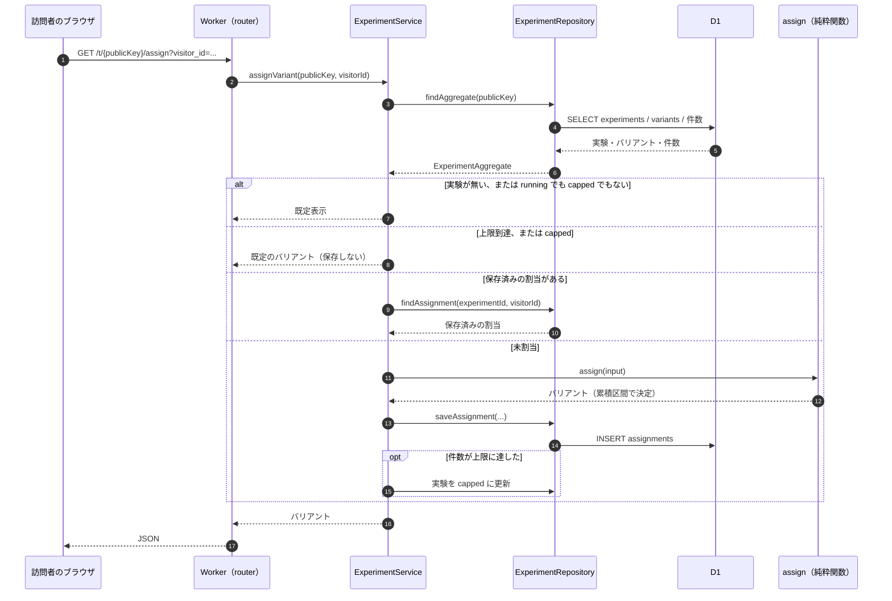
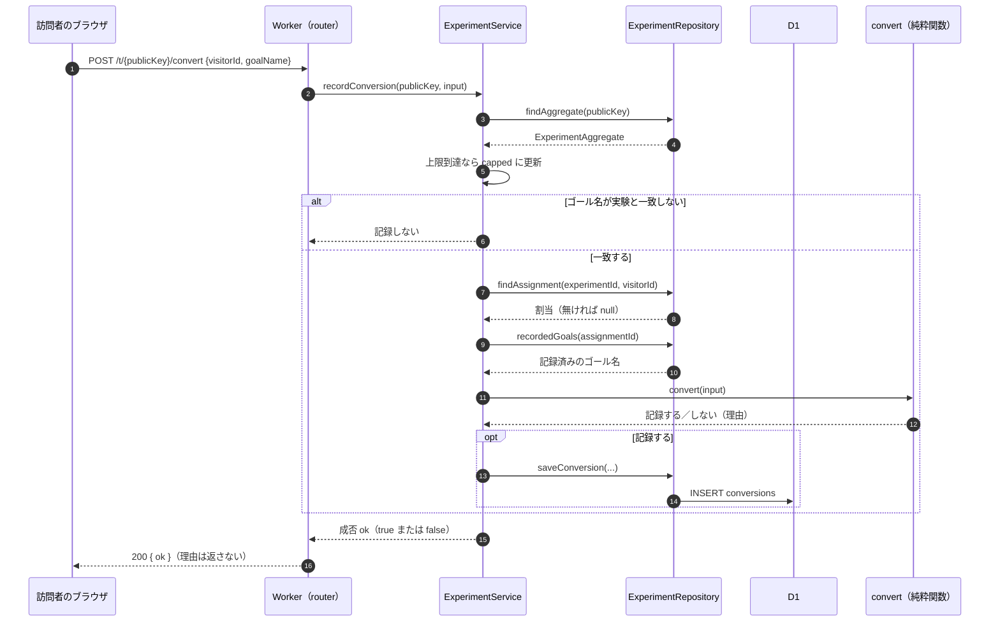
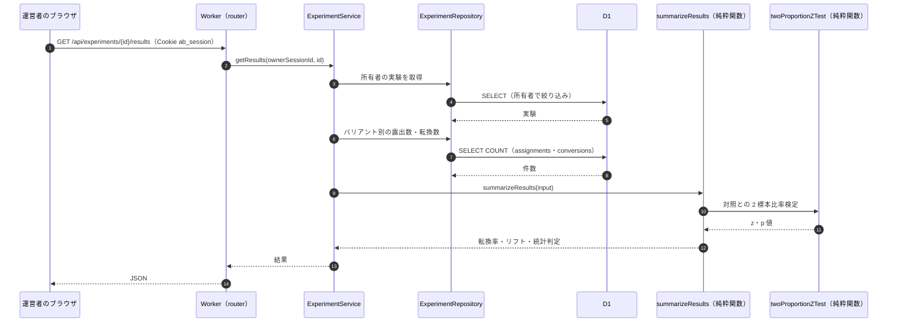

# シーケンス図（実装済み）

本書は、主要な処理の、部品どうしのやり取りを時系列で示します。図は Mermaid で書いています。

## 1. 割り当て（`GET /t/:publicKey/assign`）

## 2. 転換（`POST /t/:publicKey/convert`）

## 3. 結果の表示（`GET /api/experiments/:id/results`）

> 注：上の図は処理の順序を示します。応答コードは `src/config/http.ts` の定数が正です。
