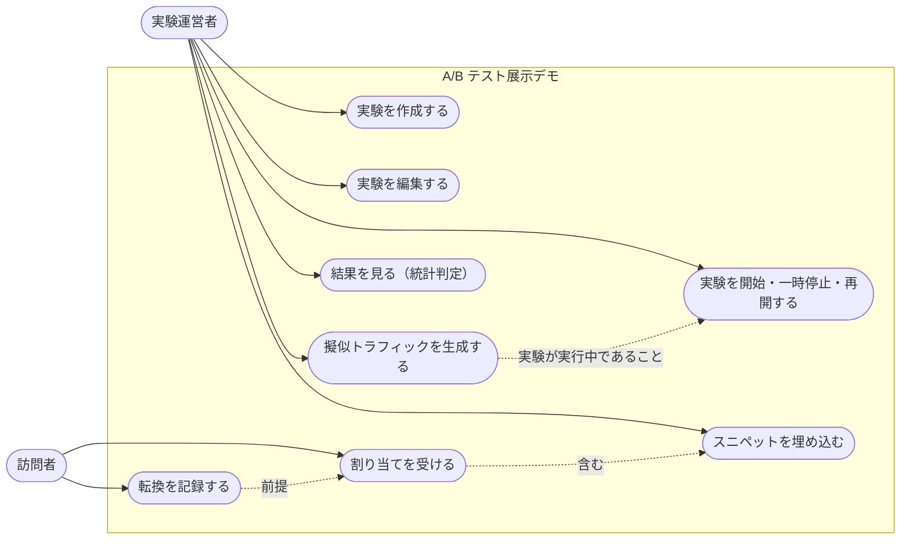

# ユースケース図（実装済み）

本書は、アクターと、実装済みのユースケースの関係を示します。図は Mermaid のフローチャートで書いています（Mermaid に専用のユースケース図は無いため）。

## ユースケースの一覧

| ユースケース | アクター | 前提 | 結果 |
|---|---|---|---|
| 実験を作成する | 運営者 | セッションの実験数が 5 件未満 | 下書き（draft）の実験ができる |
| 実験を編集する | 運営者 | 下書き、または停止中 | 名前・バリアント・配分率などが更新される |
| 実験を開始・一時停止・再開する | 運営者 | 配分率の合計 > 0、バリアント 2 件以上 | 状態が running・paused で切り替わる |
| 擬似トラフィックを生成する | 運営者 | 実行中 | 擬似の割当と転換が保存される |
| 結果を見る | 運営者 | 実験がある | 露出・転換・転換率・リフト・統計判定が表示される |
| スニペットを埋め込む | 運営者 | 実験がある | 埋め込み用のスクリプトが得られる |
| 割り当てを受ける | 訪問者 | 実行中、または上限到達（capped） | バリアントが決まり、保存される（上限到達後は既定のバリアント） |
| 転換を記録する | 訪問者 | 割り当て済み、ゴール名が一致、重複でない | 転換が保存される |

## 注記

- 「結果を見る」は、運営者本人の実験だけに使えます（所有者の Cookie で判定）。
- 訪問者は、ログインもアカウント作成もしません。
